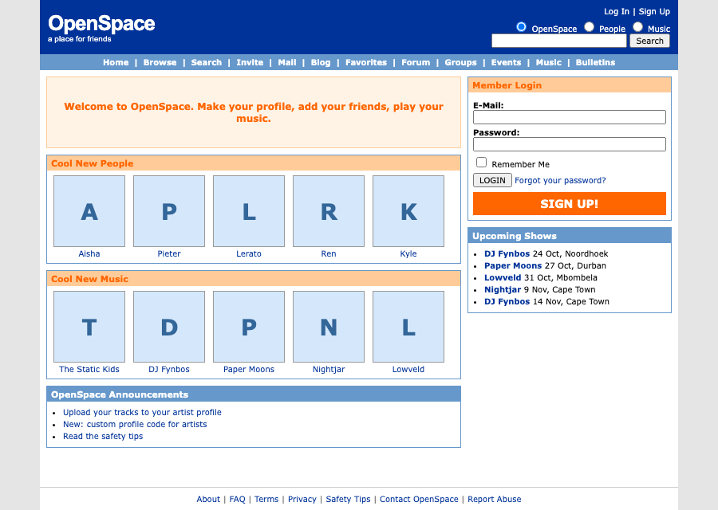

# OpenSpace

## What OpenSpace is

OpenSpace is an open source rebuild of 2006-era MySpace. It has the classic 800 pixel layout, a Top 8, profile comments, bulletins and artist pages with music players and show dates. Members can restyle their profile with CSS, and artists can add their own HTML, CSS and JavaScript. It runs on Next.js 16 and Convex.

## Features

- Fan and artist profiles with a headline, details, interests and a profile photo.
- Friend requests, a Top 8 and a friends list.
- Profile comments and bulletins, as plain text. Image links render as images.
- Artist music players with up to 10 MP3 tracks of 5 MB each, plus upcoming shows.
- Custom code. Fans get CSS, artists get HTML, CSS and JavaScript, up to 100 KB in total.
- Browse and search for people and music.
- Reports, blocks, an admin queue and bans.
- Password reset email through Resend.
- Nav items for things not built yet (Mail, Blog, Groups, Forum, Events and others) link to a coming soon page.

## How the artist sandbox works

Artists can run their own JavaScript on their profile. That is the feature that made MySpace fun, and also the one that let the 2005 Samy worm spread to more than a million profiles in a day. Samy's code ran in the same origin as the logged-in site, so it could act as whoever viewed the page. OpenSpace keeps that power and removes the risk.

- **Two origins.** The trusted site, with sign-in, editing and the friend buttons, is served from the main origin. Profile documents are served from a second origin on a different registrable domain, so browsers never share cookies between them.
- **Sandboxed iframe.** The main site shows each profile in an iframe with `sandbox="allow-scripts allow-popups"`. It never has `allow-same-origin`, so profile code cannot read the parent page, cookies or storage.
- **Content Security Policy.** The usercontent origin sends a strict CSP. `connect-src` allows only the usercontent origin and `form-action` is `'none'`, so profile code cannot call the main site's APIs or post a form to it.
- **The trusted strip.** The bar above every profile is drawn by the main site, outside the iframe. It holds the Add Friend, Comment and Report actions, so artist code cannot hide, fake or restyle it. When profile code asks for an action, it goes through a message to the parent, which asks the viewer to confirm.

The full design is in [docs/superpowers/specs/2026-10-19-openspace-design.md](docs/superpowers/specs/2026-10-19-openspace-design.md).

## Running locally

You need Node 20 or newer. Run these from the repo root.

1. Install dependencies with `npm install`.
2. Copy the example settings with `cp .env.example .env.local`.
3. Run `npx convex dev` once and create a Convex project. It writes `NEXT_PUBLIC_CONVEX_URL` into `.env.local`. Stop it when the first push finishes.
4. Fill in `.env.local`. For local work you need the two origins (`http://localhost:3000` and `http://127.0.0.1:3000`, which reach the same server by different host names, so cookies stay separate), `HOUSE_USERNAME` and `HOUSE_DISPLAY_NAME`.
5. Set the same values on the Convex deployment and add the Convex Auth keys, for example `npx convex env set HOUSE_USERNAME openspace`. [docs/deploy.md](docs/deploy.md) lists every variable and where it goes.
6. Start everything with `npm run dev`. This runs Next.js and `npx convex dev` together. Open `http://localhost:3000`.

Without `AUTH_RESEND_KEY`, sign-up and reset codes are printed to the Convex logs. Without the R2 variables, photo and track uploads do not work.

### Seed demo content

The seed creates 8 fans, 5 artists, tracks, shows, comments and bulletins. The seed accounts have no email, so nobody can sign in as them.

1. `node scripts/seed-media.mjs` generates three silent MP3s and small avatars, and uploads them to R2 when the `R2_*` variables are set. Add `--dry-run` to skip the upload.
2. `npx convex env set OPENSPACE_ALLOW_SEED 1`
3. `npx convex run seed:run`
4. `npx convex env remove OPENSPACE_ALLOW_SEED`

Running the seed again is safe.

### Tests

- `npm test` runs the Convex and unit tests with Vitest.
- `npm run test:e2e` runs the Playwright tests. They need a running Convex deployment. Set `PORT` to use a different port, and `E2E_NEXT_ONLY=1` if `npx convex dev` is already running.
- `npm run lint`, `npx tsc --noEmit` and `npm run build` should all pass.

## Deploying your own copy

[docs/deploy.md](docs/deploy.md) walks through Convex, R2, Resend and Vercel, including the two domains and the R2 CORS policy.

## Configuration

| Variable | Where | Purpose |
| --- | --- | --- |
| `NEXT_PUBLIC_MAIN_ORIGIN` | Vercel, `.env.local` | Origin of the trusted site |
| `NEXT_PUBLIC_USERCONTENT_ORIGIN` | Vercel, `.env.local` | Origin that serves profile documents. Must be a different registrable domain in production |
| `NEXT_PUBLIC_CONVEX_URL` | Vercel, `.env.local` | Convex deployment URL |
| `SITE_URL` | Convex | Main site URL used by Convex Auth for redirects |
| `JWT_PRIVATE_KEY`, `JWKS` | Convex | Convex Auth signing keys |
| `ADMIN_EMAILS` | Convex | Comma-separated emails that get admin rights |
| `HOUSE_USERNAME` | Convex | Username of the house account every new member befriends |
| `HOUSE_DISPLAY_NAME` | Convex | Display name of the house account |
| `AUTH_RESEND_KEY` | Convex | Resend API key for email |
| `AUTH_EMAIL_FROM` | Convex | From address for email |
| `R2_TOKEN` | Convex | Cloudflare R2 API token |
| `R2_ACCESS_KEY_ID` | Convex, seed script | R2 S3 access key id |
| `R2_SECRET_ACCESS_KEY` | Convex, seed script | R2 S3 secret access key |
| `R2_ENDPOINT` | Convex, seed script | R2 S3 endpoint |
| `R2_BUCKET` | Convex, seed script | R2 bucket name |
| `NEXT_PUBLIC_R2_PUBLIC_URL` | Convex | Public base URL of the bucket |
| `OPENSPACE_TEST_FIXTURES` | Convex, dev only | Enables e2e test fixtures. Never set in production |
| `OPENSPACE_ALLOW_SEED` | Convex, dev only | Allows `seed:run`. Never leave set in production |
| `PORT` | Local shell | Port for the dev server and e2e tests |

## Admins and the house account

Anyone whose verified email is in `ADMIN_EMAILS` can use the admin queue at `/admin` to review reports and ban accounts. The house account is created from `HOUSE_USERNAME` and `HOUSE_DISPLAY_NAME` when the first member signs up. Every new member starts with it as a friend and as their first Top 8 entry.

## License

OpenSpace is licensed under the [GNU Affero General Public License v3.0](LICENSE). If you run a modified copy as a public site, you must share your changes.

OpenSpace is not affiliated with MySpace. It contains no MySpace logos, icons or images.
